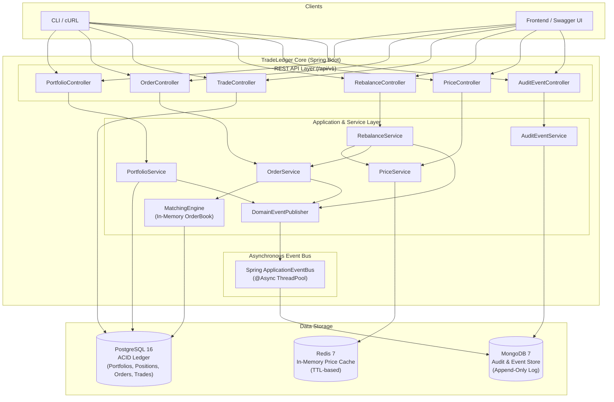

# TradeLedger

[](https://openjdk.org/projects/jdk/21/)
[](https://spring.io/projects/spring-boot)
[](https://www.postgresql.org/)
[](https://www.mongodb.com/)
[](https://redis.io/)
[](LICENSE)

**TradeLedger** is a high-performance portfolio and order management backend engineered for trading platforms, robo-advisors, and multi-asset wealth management services. Built with **Spring Boot 3.x** and **Java 21**, it features strict ACID guarantees for transactions, in-memory matching with price-time priority, an automated portfolio rebalancing engine, high-throughput price caching with Redis, and append-only audit event logging in MongoDB.

---

## 🏛 Architecture Overview

TradeLedger implements a layered domain-driven design with specialized persistence stores tailored to specific data lifecycles and performance requirements.



---

## 💡 Polyglot Storage & Design Decisions

Rather than forcing all workloads into a single database, TradeLedger employs a polyglot persistence architecture based on operational characteristics:

| Store | Data Domain | Why This Choice? |
| :--- | :--- | :--- |
| **PostgreSQL** | Portfolios, Positions, Orders, Trades, Allocations | **Strict ACID & Referential Integrity:** Financial ledgers cannot tolerate race conditions, lost updates, or orphaned trades. Optimistic locking (`@Version`) combined with PostgreSQL's serializable/read-committed transaction isolation guarantees that cash deductions and share movements occur atomically. |
| **Redis** | Live Market Prices | **Sub-millisecond Read Latency & Expiration:** Portfolios and order book operations require real-time pricing for valuation, slippage bounds, and drift calculations. In-memory key-value caching with configurable TTL (default: 10s) eliminates database and external provider bottleneck. |
| **MongoDB** | Domain Audit Events (`ORDER_CREATED`, `ORDER_FILLED`, `CASH_DEPOSITED`, etc.) | **Append-Heavy & Flexible Schemas:** Financial compliance requires immutable audit trails. Audit payloads vary drastically across event types (e.g. order details vs. rebalancing diffs). MongoDB provides horizontal scalability, zero-schema lock-in, and high write throughput without degrading transactional query performance. |

---

## ⚡ Database Indexing Strategy

All database schemas are managed through Flyway (`src/main/resources/db/migration`). Every index is deliberately designed to satisfy high-frequency query patterns:

| Index Name | Table | Columns | Query Pattern / Justification |
| :--- | :--- | :--- | :--- |
| `idx_orders_portfolio_status` | `orders` | `(portfolio_id, status)` | Fast retrieval of active/pending orders per portfolio during order placement checks and dashboard rendering. Avoids full-table sequential scans. |
| `idx_position_portfolio` | `position` | `(portfolio_id)` | Look up all held symbols for valuation and drift calculation during rebalance runs. |
| `idx_trade_symbol_time` | `trade` | `(symbol, executed_at DESC)` | Powers market trade history displays and volume analysis, optimizing range queries with reverse chronologic ordering. |
| `idx_trade_buy_order` | `trade` | `(buy_order_id)` | Resolves trade history belonging to a specific buyer order or portfolio. |
| `idx_trade_sell_order` | `trade` | `(sell_order_id)` | Resolves trade history belonging to a specific seller order or portfolio. |
| `idx_target_alloc_portfolio` | `target_allocation` | `(portfolio_id)` | Batch loading of all portfolio target weights for the rebalance engine. |
| `orders.idempotency_key` | `orders` | `(idempotency_key)` | Enforces unique constraint and provides immediate B-Tree index lookup for duplicate request deduplication. |

---

## 🛠 Tech Stack

- **Runtime:** Java 21 LTS
- **Framework:** Spring Boot 3.3.5 (Spring MVC, Spring Data JPA, Spring Data Redis, Spring Data MongoDB, Validation, Actuator)
- **Databases:** PostgreSQL 16, MongoDB 7.0, Redis 7.0
- **Database Migrations:** Flyway
- **Documentation:** springdoc-openapi 2.6.0 (Swagger 3 / OpenAPI UI)
- **Testing:** JUnit 5, Mockito, AssertJ, Testcontainers (Postgres, Mongo, Redis)
- **Containerization:** Docker & Docker Compose

---

## 🚀 Getting Started

### Prerequisites

- **Java 21+** (`java --version`)
- **Docker & Docker Compose** (for running datastores locally and Testcontainers)

### 1. Start Infrastructure via Docker Compose

Run PostgreSQL, MongoDB, and Redis with healthchecks pre-configured:

```bash
docker compose up -d
```

Verify services are healthy:
```bash
docker compose ps
```

### 2. Build & Run the Application

The project includes the Maven Wrapper (`mvnw`), so no global Maven installation is required:

```bash
# Compile and package
./mvnw clean package -DskipTests

# Run application
./mvnw spring-boot:run
```

Once started, the application will be available at `http://localhost:8080`.

### 3. Interactive API Docs (Swagger UI)

Navigate to:
- **Swagger UI:** [http://localhost:8080/swagger-ui.html](http://localhost:8080/swagger-ui.html)
- **OpenAPI JSON:** [http://localhost:8080/api-docs](http://localhost:8080/api-docs)

---

## 📡 REST API Reference & cURL Examples

All endpoints are versioned under `/api/v1`.

### 1. Create a Portfolio

```bash
curl -X POST http://localhost:8080/api/v1/portfolios \
  -H "Content-Type: application/json" \
  -d '{"name": "Growth Tech Fund"}'
```

**Response (`201 Created`):**
```json
{
  "id": "7f000001-935f-178b-8193-5f80bfa10000",
  "name": "Growth Tech Fund",
  "cashBalance": 0.0000,
  "createdAt": "2026-11-24T19:20:00"
}
```

---

### 2. Deposit Cash into Portfolio

```bash
curl -X POST http://localhost:8080/api/v1/portfolios/7f000001-935f-178b-8193-5f80bfa10000/deposit \
  -H "Content-Type: application/json" \
  -d '{"amount": 50000.00}'
```

**Response (`200 OK`):**
```json
{
  "id": "7f000001-935f-178b-8193-5f80bfa10000",
  "name": "Growth Tech Fund",
  "cashBalance": 50000.0000,
  "createdAt": "2026-11-24T19:20:00"
}
```

---

### 3. List Positions with Real-Time Valuation

Returns all holdings with market value, unrealized P&L, and portfolio weight:

```bash
curl -X GET http://localhost:8080/api/v1/portfolios/7f000001-935f-178b-8193-5f80bfa10000/positions
```

**Response (`200 OK`):**
```json
[
  {
    "id": "6a110002-1234-5678-90ab-cdef12345678",
    "portfolioId": "7f000001-935f-178b-8193-5f80bfa10000",
    "symbol": "AAPL",
    "quantity": 50.0000,
    "avgCost": 150.0000,
    "currentPrice": 185.5000,
    "marketValue": 9275.0000,
    "unrealizedPnL": 1775.0000,
    "weight": 0.156540
  }
]
```

---

### 4. Place an Order (with Idempotency Key)

```bash
curl -X POST http://localhost:8080/api/v1/portfolios/7f000001-935f-178b-8193-5f80bfa10000/orders \
  -H "Content-Type: application/json" \
  -H "Idempotency-Key: ord-req-98234-a1" \
  -d '{
    "symbol": "AAPL",
    "side": "BUY",
    "type": "LIMIT",
    "quantity": 25,
    "limitPrice": 182.00
  }'
```

---

### 5. Rebalancing Endpoints

- **Preview Proposal (Zero side-effects):**
  ```bash
  curl -X POST http://localhost:8080/api/v1/portfolios/7f000001-935f-178b-8193-5f80bfa10000/rebalance/preview
  ```

- **Execute Rebalance (Submits sell orders first, then buy orders):**
  ```bash
  curl -X POST http://localhost:8080/api/v1/portfolios/7f000001-935f-178b-8193-5f80bfa10000/rebalance/execute
  ```

---

### 6. Audit Trail & Compliance Events

```bash
curl -X GET "http://localhost:8080/api/v1/portfolios/7f000001-935f-178b-8193-5f80bfa10000/audit-events?type=ORDER_FILLED"
```

---

## 🧪 Running Tests

Execute unit tests:
```bash
./mvnw test -Dtest=*Test
```

Execute end-to-end integration tests using Testcontainers (requires Docker daemon):
```bash
./mvnw verify
```

---

## 🔒 Financial Precision & Concurrency Guarantees

1. **BigDecimal Math:** Zero floating-point arithmetic. All balances, share quantities, costs, and weights are calculated using `BigDecimal` with explicit rounding modes (`RoundingMode.HALF_UP`).
2. **Optimistic Locking:** Every mutate operation on `Portfolio`, `Position`, and `Order` is guarded by JPA `@Version`.
3. **In-Memory Matching Engine:** Per-symbol `ReentrantLock` guarantees FIFO price-time priority without race conditions between competing limit/market orders.
4. **Idempotency:** Network drops or duplicate submissions with identical `Idempotency-Key` headers return the existing order rather than double-booking cash or shares.

---

## 📄 License

This project is licensed under the [MIT License](LICENSE).
